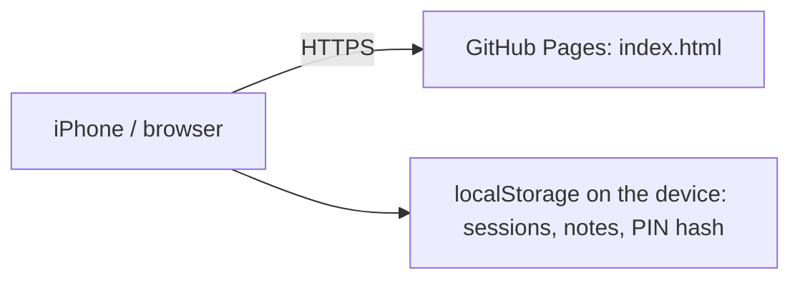

# atlas

Personal training, plan and nutrition tracker for the iPhone home screen: one file (`index.html`, no build, no server, Russian UI). Served by GitHub Pages at https://cerberdll.github.io/atlas/ (legacy Pages build from `main`, path `/`).

## Architecture

- Sections: Training (three-day full-body split A/B/C with last-session comparison and progression hint), Plan, Nutrition, Notes.
- Data stays in the browser (`localStorage`, or `window.storage` where the host offers it); nothing is sent anywhere. A PIN lock (hash in `localStorage`) guards the page.
- The repo is public because free GitHub Pages needs it; it holds the training plan and decision notes, no logged sessions or measurements.

## Install, update, rollback

- Use: open the Pages URL in Safari, Share, Add to Home Screen.
- Update: commit `index.html` to `main`; Pages publishes in about a minute. Rollback: `git revert` the commit.
- Backup of the logged data: none yet (it lives only on the device); open item.

## Status

CURRENT, last change 2026-09-04. Owner: the repo owner; no agent maintains it.
